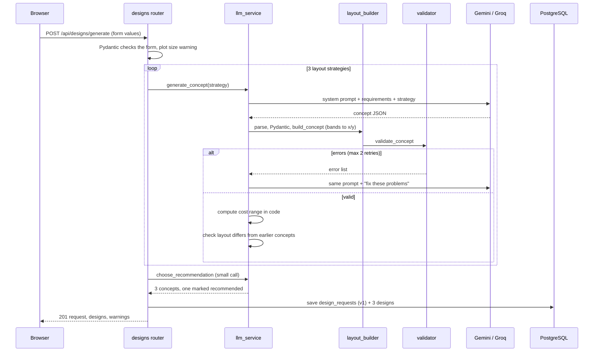
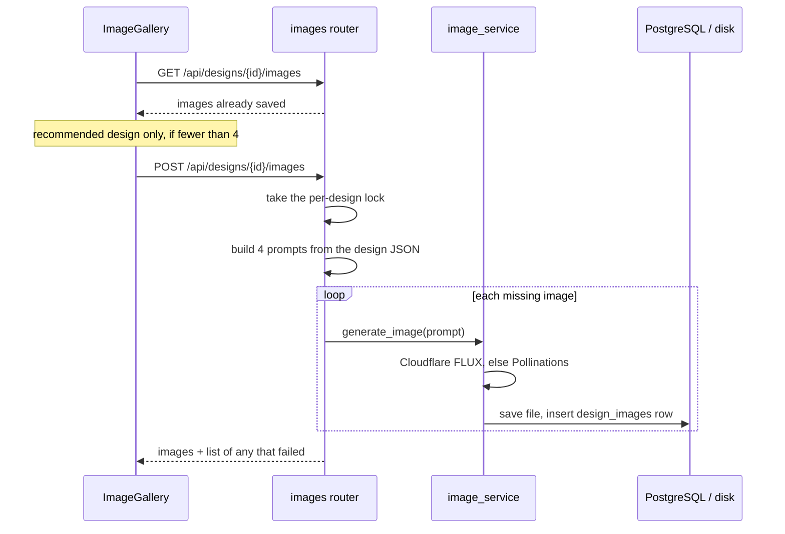

# Architecture and request flow

## Components

| Layer | Files | Job |
|---|---|---|
| UI | `frontend/src/components/*` | Form, concept tabs, SVG plans, image gallery, version and modify panel |
| API client | `frontend/src/api/client.js` | Every backend call, with a timeout and readable errors |
| Routers | `routers/designs.py`, `routers/images.py` | HTTP endpoints, status codes, saving to the database |
| LLM | `services/llm_service.py` | Gemini then Groq, JSON parsing, retry with validation errors |
| Prompts | `prompts/design_prompt.py`, `services/prompt_builder.py` | System prompt, layout strategies, feasibility hint, image prompts |
| Layout builder | `services/layout_builder.py` | Turns the LLM's bands (rows of rooms with widths) into rooms with x/y, so nothing can overlap |
| Opening planner | `services/opening_planner.py` | Places doors and windows from the room geometry (doors only on shared walls, windows only on outside walls) |
| Validator | `services/floorplan_validator.py` | Rules every plan must pass |
| Images | `services/image_service.py` | Cloudflare then Pollinations, saving files |
| Data | `models.py`, `database.py`, `schemas.py` | Tables, sessions, Pydantic models |

## Flow 1: generate designs (new project, v1)



Steps in words:
1. The form is validated by Pydantic. A plot size that is more than 10% away from width x length only adds a warning.
2. Each concept gets its own LLM call with one of three layout strategies. This is what makes the layouts differ, and it keeps each call small enough for Groq's free token limit.
3. Each reply must pass JSON parsing and the Pydantic shape. The LLM describes each floor as bands (rows) with a height and room widths, and no coordinates. `layout_builder.py` repairs small arithmetic slips (a room below its minimum, widths or heights that do not add up) without going below any minimum, then places every room, so overlaps and out-of-bounds rooms cannot happen. It picks each band's height so its rooms' minimum widths fit the plot (a room needs less width in a taller band). It rejects a band only when its rooms cannot fit at any height, or when the bands together are too tall, and the message says how much space is needed. `opening_planner.py` then adds the doors and windows from the room positions. The floor plan validator checks the rest. Failures go back to the LLM with the exact error messages. After 3 tries (set by `LLM_MAX_RETRIES`) the request fails with 502.
4. The cost range is computed in code from the room area and the style's rate range.
5. A concept whose kitchen corner and parking side match an earlier concept is rejected as too similar.
6. A final call picks the recommended concept. A simple budget rule is the fallback.
7. Nothing is saved until all 3 concepts are ready, so a failure leaves no half-saved data.

## Flow 2: images



- All four prompts share the style words and colour palette so they look like one house.
- The exterior prompt mentions parking only when it was requested.
- The lock stops duplicate clicks from spending quota twice.
- After 2 failures in a row it stops trying, since that usually means a quota or key problem.
- The recommended design generates on its own when it is shown. Other designs wait for the button.

## Flow 3: modify and versions

1. The panel shows the saved values of the version being viewed.
2. Only the edited fields are sent to `POST /api/designs/{request_id}/modify`.
3. The backend drops values that did not really change. If nothing is left it answers 422.
4. It copies the base version, applies the edits, and runs Flow 1 again.
5. The result is saved with the same `project_id`, the next `version_number`, and `parent_request_id` set to the version it came from.
6. `GET /api/designs/projects/{project_id}/versions` compares each version with its parent to produce the change list.
7. Older versions are read with `GET /api/designs/{request_id}`. This never calls an AI.

A unique constraint on `(project_id, version_number)` prevents two simultaneous modifies from taking the same version number. The loser gets 409.

## Data model

```
design_requests  id, project_id, version_number, parent_request_id,
                 plot_size_sqft, plot_width_ft, plot_length_ft, bhk_type, bathrooms,
                 floors, budget_inr, style, parking, created_at
      1 --- *
designs          id, request_id, concept_name, concept_json, is_recommended, created_at
      1 --- *
design_images    id, design_id, image_type, file_path, provider, created_at
```

`concept_json` holds the full plan: floors, rooms, doors, windows, parking, advantages, budget note, colour palette and feasibility note.

## Error handling

| Code | Meaning |
|---|---|
| 422 | Invalid form values, or a modify request that changes nothing |
| 404 | Unknown request, design or project |
| 409 | Version number conflict |
| 502 | The AI answered, but no valid plan came out after retries |
| 503 | Every LLM or image provider failed (the message lists each reason) |
| 500 | Database save failed |

The frontend shows these messages in a red box and disables the buttons while a request is running.
